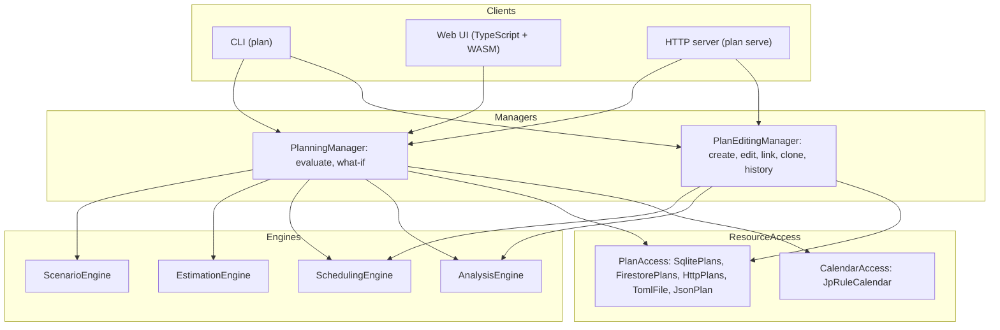

# Design

## Goal

Make schedule planning cheap enough to redo whenever something changes: write the plan once, compare options in seconds, and let an AI assistant read and edit the plan as safely as a person.

Non-goals: tracking status, assigning work, syncing with issue trackers. Tickets stay in the tracker; a task links to them through `ticket` or a comment.

## Decisions

| Topic | Decision | Why |
|---|---|---|
| Scope | Calculation and display only | Status already has an owner (the issue tracker); two sources of truth drift |
| Unit | Epic > story > task. Only tasks are scheduled; stories and epics are containers | Matches how work is broken down in trackers |
| Language | Rust for everything that computes; TypeScript for the UI | One scheduler. The browser runs the same Rust as WebAssembly, so drag-and-drop re-plans with the exact rules the CLI uses |
| UI framework | None | The views are SVG redrawn from computed results; state is small. A framework would add a dependency chain without paying for itself |
| Types across the boundary | Defined once in `plan-contracts`, exported to TypeScript with ts-rs | A change in Rust breaks the TypeScript build instead of the UI at runtime |
| Storage | SQLite locally, Firestore on Cloud Run, both behind one interface | Free at this size, JSON-shaped documents are easy for an AI to read |
| AI entry point | CLI with `--json` and batched, atomic edits (`plan apply`) | A shell is available to every coding assistant. An MCP server can be added as one more client without touching the rest |
| Service dependencies | None in the code | The tool is general; links to trackers are plain URLs in comments |

## Volatility

The structure follows *The Method* (Löwy, *Righting Software*, part 1): each area that is likely to change is encapsulated in one component.

| Volatility | Likelihood | Encapsulated in |
|---|---|---|
| Where and how plans are stored (TOML, SQLite, Firestore, a remote server) | high | `PlanAccess` implementations |
| How edits are made (CLI, UI, batch, future MCP) | high | `PlanEditingManager` and the clients |
| Which scenarios are compared | high | `ScenarioEngine` |
| How durations are estimated (PERT, rounding, utilization) | medium | `EstimationEngine` |
| How tasks are placed (resources, freezes, ordering rule) | medium | `SchedulingEngine` |
| How a plan is judged (float colors, risk metrics, lint) | medium | `AnalysisEngine` |
| Where the calendar comes from (holiday rules) | low | `CalendarAccess` |

Stable: the unit of calculation is one epic; dependencies stay inside an epic; time is counted in business half-days.

## Components

- Managers receive `Arc<dyn PlanAccess>`; they never know which store or client is in use.
- The browser receives one epic as JSON and runs `PlanningManager` in WASM (`JsonPlan`). Edits go to the server's HTTP API.
- The CLI uses `HttpPlans` when a server is configured, so the same commands work against a local SQLite file or a deployed service.
- Every store applies a batch of edits in one transaction: read, mutate, validate with the engines (loops, unknown tasks), write the plan and one history entry per edit. A batch with any error writes nothing.

## Data

| Firestore | SQLite | Content |
|---|---|---|
| `epics/{key}` | `epics`, `stories`, `tasks`, `deps`, `scenarios`, `comments` | the plan; Firestore stores the `Plan` JSON as the document (arrays inside arrays are wrapped as `{"_a": [...]}`) |
| `history/{id}` | `history` | one change: id, time, actor (`cli`, `mcp`, `web`, `push`, `import`), epic, op, payload (JSON) |
| `meta/state` | `MAX(history.id)` | version; the UI polls it and reloads when it changes |

## UI rules

- No explanatory text under headings; definitions live in tooltips and the Help page.
- Every drag has a keyboard alternative; drags start after 4 px.
- Color is never the only signal: critical tasks have a thick outline and bold labels, waits are hatched, production tasks have a marker.
- Float uses one hue (blue, dark to light) plus orange for critical, so it reads under red–green color vision deficiency; borders reach 3:1 contrast (WCAG 2.1 SC 1.4.11).

## Verification

- The scheduler matches the original Python implementation on all 27 runs of `examples/sample.toml` (start, finish, float, free float, risk).
- Holidays 2025–2030 match the Python `holidays` package.
- The TypeScript build type-checks against the Rust types on every build.
